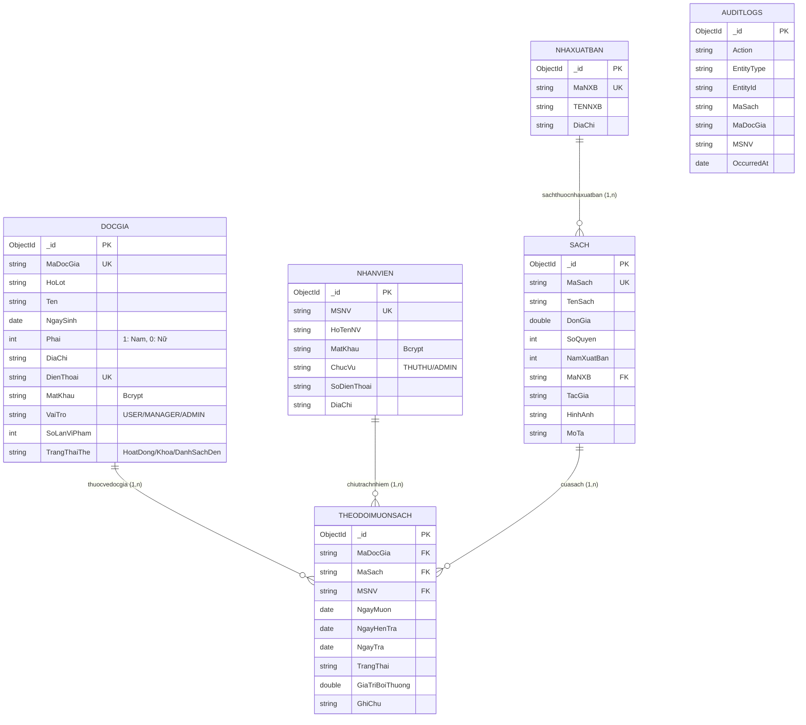

# 02. THIẾT KẾ CƠ SỞ DỮ LIỆU (DATABASE SCHEMA)

* **Hệ Quản Trị CSDL**: MongoDB (Native Driver v6+)
* **Tên Database**: `quanlymuonsach`
* **Quy chuẩn**: 5 collections nghiệp vụ cốt lõi bám sát Sơ đồ CDM trong Báo cáo thực tập CT449 (Chương III, Mục 2, Trang 23-25); `auditlogs` là collection kỹ thuật bổ sung cho truy cứu hoạt động.

Các trường liệt kê trong 5 collections nghiệp vụ là lược đồ CDM. Backend có thể lưu metadata kỹ thuật (`CreatedAt`, `UpdatedAt`, `deleted`, `DeletedAt`, `DeletedBy`); metadata xóa không xuất hiện trong response sách đang hoạt động. Riêng Admin có endpoint xem sách đã xóa mềm để khôi phục, endpoint này trả metadata xóa. `auditlogs` có schema API riêng, không phải response tài nguyên CDM. Mọi response loại trừ `MatKhau`.

---

## 1. Danh Sách Tập Hợp (Collections)

| STT | Tên Collection | Diễn Giải Nghiệp Vụ |
|:---:|:---|:---|
| 1 | `docgia` | Danh sách thông tin tài khoản độc giả và trạng thái thẻ |
| 2 | `nhanvien` | Danh sách tài khoản nhân viên thư viện và quản trị viên |
| 3 | `nhaxuatban` | Danh mục thông tin các nhà xuất bản |
| 4 | `sach` | Danh mục thông tin các đầu sách và số lượng tồn kho |
| 5 | `theodoimuonsach` | Nhật ký theo dõi giao dịch mượn, trả sách và xử lý sự cố |
| 6 | `auditlogs` | Nhật ký kiểm toán append-only, lưu actor, đối tượng, sự kiện và thời điểm; chỉ Admin được đọc qua API |

---

## 2. Chi Tiết Lược Đồ Dữ Liệu Từng Bảng (Schema Specification)

### 2.1. Bảng Độc Giả (`docgia`)
Bảng `docgia` dùng để lưu trữ thông tin cá nhân của người mượn sách, thông tin tài khoản đăng nhập, cấp bậc phân quyền và các chỉ số theo dõi vi phạm nội quy để xử lý đưa vào danh sách đen.

```json
{
  "_id": "ObjectId",                  // [Khóa chính PK] Định danh duy nhất tự sinh bởi MongoDB
  "MaDocGia": "DG-000001",            // [Duy nhất] Mã số định danh độc giả (Tự sinh hệ thống)
  "HoLot": "Trần Minh",               // [Bắt buộc] Họ và tên đệm của độc giả
  "Ten": "Triết",                     // [Bắt buộc] Tên của độc giả
  "NgaySinh": "2003-09-15",           // [Bắt buộc] Ngày tháng năm sinh (Định dạng YYYY-MM-DD)
  "Phai": 1,                          // [Bắt buộc, Integer] Giới tính: 1: Nam, 0: Nữ, 2: Khác
  "DiaChi": "Xuân Khánh, Cần Thơ",   // Địa chỉ cư trú của độc giả
  "DienThoai": "0912345678",          // [Bắt buộc, Duy nhất] Số điện thoại liên hệ (Dùng để đăng nhập)
  "MatKhau": "$2a$10$e7...",          // [Bắt buộc, String] Mật khẩu tài khoản (Đã mã hóa Bcrypt an toàn)
  "VaiTro": "USER",                   // [USER | MANAGER | ADMIN] Vai trò người dùng trong hệ thống
  "SoLanViPham": 0,                   // [Number >= 0] Số lần vi phạm nội quy (trả trễ hạn, làm mất sách)
  "TrangThaiThe": "HoatDong"          // ["HoatDong" | "Khoa" | "DanhSachDen"] Trạng thái thẻ thư viện
}
```

* **Quy tắc Danh sách đen tự động**: Khi số lần vi phạm tăng đến ngưỡng 3, hệ thống tự động chuyển `TrangThaiThe = "DanhSachDen"` và từ chối yêu cầu mượn mới. Trạng thái khóa khẩn cấp (`Khoa`) là nghiệp vụ riêng, không làm thay đổi số lần vi phạm; mở khóa khẩn cấp ở ngưỡng 3 sẽ chuyển về `DanhSachDen`. Admin có thể xét gỡ khỏi Danh sách đen qua thao tác riêng nhưng không xóa lịch sử `SoLanViPham`; nếu phát sinh vi phạm mới, hệ thống áp dụng lại chế tài.

---

### 2.2. Bảng Nhân Viên (`nhanvien`)
Bảng `nhanvien` lưu trữ danh sách cán bộ, nhân viên thư viện và quản trị viên hệ thống có quyền đăng nhập vào các phân hệ nghiệp vụ quản lý.

```json
{
  "_id": "ObjectId",                  // [Khóa chính PK] Định danh duy nhất tự sinh bởi MongoDB
  "MSNV": "NV-0001",                  // [Duy nhất] Mã số nhân viên (Tự sinh chuẩn NV-0001)
  "HoTenNV": "Nguyễn Quản Trị Viên", // [Bắt buộc] Họ và tên đầy đủ của nhân viên
  "MatKhau": "$2a$10$k9...",          // [Bắt buộc] Mật khẩu đăng nhập hệ thống (Đã mã hóa Bcrypt)
  "ChucVu": "ADMIN",                  // ["THUTHU" | "ADMIN"] Chức danh công tác
  "SoDienThoai": "0901234567",        // Số điện thoại nhân viên
  "DiaChi": "Ninh Kiều, Cần Thơ"     // Địa chỉ liên hệ của nhân viên
}
```

---

### 2.3. Bảng Sách (`sach`)
Lưu trữ thông tin chi tiết từng đầu sách trong thư viện, bao gồm đơn giá bồi thường và số lượng tồn kho thực tế.

```json
{
  "_id": "ObjectId",                  // [Khóa chính PK] Định danh duy nhất tự sinh bởi MongoDB
  "MaSach": "SACH-000001",            // [Duy nhất] Mã định danh đầu sách (Tự sinh SACH-000001)
  "TenSach": "Lập trình Web Vue.js",  // [Bắt buộc] Tên tựa sách
  "DonGia": 85000,                    // [Bắt buộc, Double >= 0] Đơn giá sách (Dùng tính tiền phạt nếu làm mất)
  "SoQuyen": 5,                       // [Bắt buộc, Integer >= 0] Số lượng sách thực tế còn trong kho
  "NamXuatBan": 2024,                 // [Integer] Năm xuất bản sách
  "MaNXB": "NXB-0001",                // [Khóa ngoại FK] Tham chiếu đến nhaxuatban.MaNXB
  "TacGia": "Nguyễn Văn An",          // [Bắt buộc] Tên tác giả hoặc cơ quan biên soạn
  "HinhAnh": "https://...",           // Đường dẫn ảnh bìa sách
  "MoTa": "Giáo trình toàn diện..."  // Tóm tắt nội dung sách
}
```

* **Xóa mềm**: `DELETE /api/sach/:id` đặt `deleted=true`, `DeletedAt`, `DeletedBy`, không xóa document. Sách đã xóa bị ẩn khỏi tra cứu/chi tiết và không thể đăng ký/duyệt mượn. Chỉ Admin được xem danh sách xóa mềm và khôi phục (`deleted=false`); mọi thao tác được ghi log. Bản ghi cũ thiếu `deleted` được hiểu là đang hoạt động.
* **Ràng buộc toàn vẹn**: Không cho phép xóa mềm nếu sách đang có phiếu `DangMuon` hoặc `ChoDuyet`.
* `deleted`, `DeletedAt`, `DeletedBy` là metadata kỹ thuật ngoài CDM; chỉ endpoint danh sách đã xóa dành cho Admin trả các trường này.

---

### 2.4. Bảng Nhà Xuất Bản (`nhaxuatban`)
Lưu trữ danh mục các đơn vị xuất bản cung cấp ấn phẩm cho thư viện.

```json
{
  "_id": "ObjectId",                  // [Khóa chính PK] Định danh duy nhất tự sinh bởi MongoDB
  "MaNXB": "NXB-0001",                // [Duy nhất] Mã định danh nhà xuất bản (Tự sinh NXB-0001)
  "TENNXB": "NXB Giáo Dục Việt Nam", // [Bắt buộc] Tên nhà xuất bản (Chuẩn báo cáo CDM)
  "DiaChi": "81 Trần Hưng Đạo, HN"    // Địa chỉ trụ sở nhà xuất bản
}
```

* **Ràng buộc toàn vẹn**: Không cho phép xóa Nhà xuất bản nếu vẫn còn sách trong kho tham chiếu đến `MaNXB` này.

---

### 2.5. Bảng Theo Dõi Mượn Sách (`theodoimuonsach`)
Bảng `theodoimuonsach` đóng vai trò là bảng giao dịch trung gian giữa `docgia` và `sach`, ghi nhận toàn bộ vòng đời của một phiếu mượn từ lúc gửi yêu cầu, duyệt giao sách, hẹn ngày trả, cho đến khi hoàn trả hoặc xử lý bồi thường mất sách.

```json
{
  "_id": "ObjectId",                  // [Khóa chính PK] Định danh duy nhất tự sinh bởi MongoDB
  "MaDocGia": "DG-000001",            // [Khóa ngoại FK] Tham chiếu đến docgia.MaDocGia
  "MaSach": "SACH-000004",            // [Khóa ngoại FK] Tham chiếu đến sach.MaSach
  "NgayMuon": "2026-10-14",           // Ngày độc giả gửi yêu cầu hoặc bắt đầu nhận sách (YYYY-MM-DD)
  "MSNV": "NV-0002",                  // [Khóa ngoại FK] Mã số nhân viên phụ trách duyệt (nhanvien.MSNV)
  "NgayHenTra": "2026-10-28",         // Hạn trả sách dự kiến (Mặc định 14 ngày kể từ ngày duyệt)
  "NgayTra": null,                    // Ngày thực tế mang trả sách tại quầy (null nếu chưa trả)
  "TrangThai": "DangMuon",            // ["ChoDuyet" | "DangMuon" | "DaTra" | "MatSach" | "TuChoi"]
  "GiaTriBoiThuong": 0,               // [Double >= 0] Tiền bồi hoàn theo đơn giá nếu làm mất sách
  "GhiChu": "Sách bìa cứng, mới"      // Lý do từ chối mượn hoặc ghi chú tình trạng sách lúc trả
}
```

### 2.6. Nhật Ký Kiểm Toán (`auditlogs`)

Collection kỹ thuật append-only, lưu snapshot tên/mã để còn truy cứu sau khi sách xóa mềm hoặc tên hiển thị thay đổi. Không có API sửa/xóa log.

```json
{
  "_id": "ObjectId",
  "Action": "BORROW_APPROVED",
  "EntityType": "borrow",
  "EntityId": "ObjectId hoặc MaSach",
  "MaSach": "SACH-000001",
  "TenSach": "Lập trình Web Vue.js",
  "MaDocGia": "DG-000001",
  "TenDocGia": "Trần Minh Triết",
  "MSNV": "NV-0002",
  "TenNhanVien": "Nguyễn Thủ Thư",
  "ActorType": "staff",
  "ActorId": "NV-0002",
  "ActorName": "Nguyễn Thủ Thư",
  "Details": { "from": "ChoDuyet", "to": "DangMuon" },
  "OccurredAt": "2026-10-23T10:00:00.000Z"
}
```

Action gồm `BOOK_CREATED`, `BOOK_UPDATED`, `BOOK_SOFT_DELETED`, `BOOK_RESTORED`, `BORROW_REQUESTED`, `BORROW_APPROVED`, `BORROW_REJECTED`, `BOOK_RETURNED`, `BOOK_REPORTED_LOST` và `BORROW_RECORD_DELETED`. Actor được xác định từ JWT phía server, không tin mã do client tự khai.

---

## 3. Sơ Đồ Quan Hệ Dữ Liệu (Entity Relationship Diagram - ERD)


