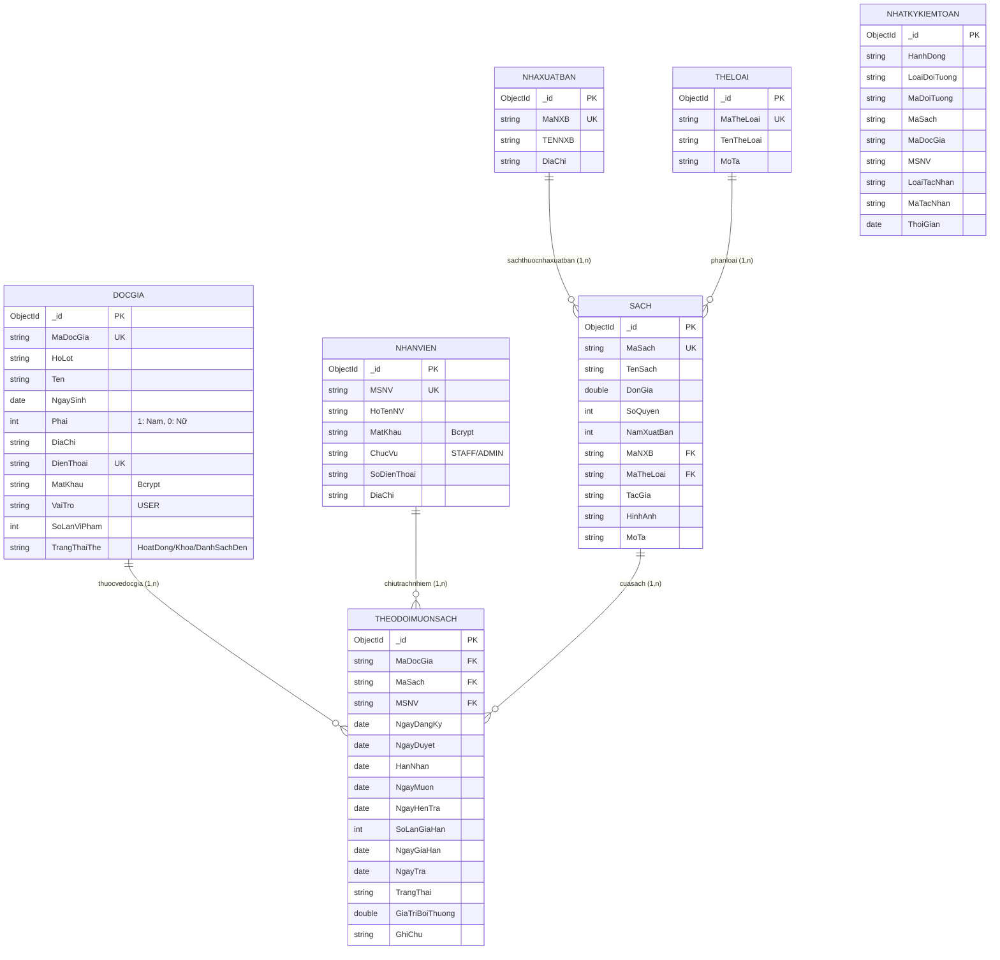

# 02. THIẾT KẾ CƠ SỞ DỮ LIỆU (DATABASE SCHEMA)

* **Hệ Quản Trị CSDL**: MongoDB (Native Driver v6+)
* **Tên Database**: `quanlymuonsach`
* **Vai trò chuẩn**: `USER` (độc giả), `STAFF` (thủ thư/nhân viên), `ADMIN` (quản trị viên). `nhanvien.ChucVu` chỉ nhận `STAFF` hoặc `ADMIN`; `docgia.VaiTro` chỉ nhận `USER`.
* **Quy chuẩn**: 5 collections nghiệp vụ cốt lõi bám sát Sơ đồ CDM trong Báo cáo thực tập CT449 (Chương III, Mục 2, Trang 23-25), mở rộng thêm collection tham chiếu `theloai`; `yeucaunhanvien`, `nhatkykiemtoan` và `thongbao` là collection kỹ thuật.

Các trường nghiệp vụ là lược đồ CDM, bổ sung thể loại tham chiếu riêng `theloai`. Backend có thể lưu metadata kỹ thuật (`CreatedAt`, `UpdatedAt`, `deleted`, `DeletedAt`, `DeletedBy`); metadata xóa không xuất hiện trong response sách đang hoạt động. Riêng Admin có endpoint xem sách đã xóa mềm để khôi phục, endpoint này trả metadata xóa. `nhatkykiemtoan` có schema riêng, dùng tên trường tiếng Việt và không phải response tài nguyên CDM. Mọi response loại trừ `MatKhau`.

---

## 1. Danh Sách Tập Hợp (Collections)

| STT | Tên Collection | Diễn Giải Nghiệp Vụ |
|:---:|:---|:---|
| 1 | `docgia` | Danh sách thông tin tài khoản độc giả và trạng thái thẻ |
| 2 | `nhanvien` | Danh sách tài khoản nhân viên thư viện và quản trị viên |
| 3 | `nhaxuatban` | Danh mục thông tin các nhà xuất bản |
| 4 | `sach` | Danh mục thông tin các đầu sách và số lượng tồn kho |
| 5 | `theloai` | Danh mục thể loại sách; sách tham chiếu bằng `MaTheLoai` |
| 6 | `theodoimuonsach` | Nhật ký theo dõi giao dịch mượn, trả sách và xử lý sự cố |
| 7 | `nhatkykiemtoan` | Nhật ký kiểm toán append-only, lưu tác nhân, đối tượng, sự kiện và thời điểm; chỉ Admin được đọc qua API |
| 8 | `thongbao` | Hộp thư thông báo nghiệp vụ theo từng độc giả/nhân viên; chỉ người nhận được đọc và đánh dấu đã đọc |
| 9 | `yeucaunhanvien` | Hồ sơ đăng ký nhân viên riêng, được Admin duyệt trước khi tạo tài khoản nhân viên |

---

## 2. Chi Tiết Lược Đồ Dữ Liệu Từng Bảng (Schema Specification)

### 2.1. Bảng Độc Giả (`docgia`)
Bảng `docgia` lưu thông tin cá nhân người mượn sách, tài khoản độc giả (`VaiTro: USER`) và các chỉ số vi phạm nội quy.

```json
{
  "_id": "ObjectId",                  // [Khóa chính PK] Định danh duy nhất tự sinh bởi MongoDB
  "MaDocGia": "DG-000001",            // [Duy nhất] Mã số định danh độc giả (Tự sinh hệ thống)
  "HoLot": "Trần Minh",               // [Bắt buộc] Họ và tên đệm của độc giả
  "Ten": "Triết",                     // [Bắt buộc] Tên của độc giả
  "NgaySinh": "2003-09-15",           // [Bắt buộc] Ngày tháng năm sinh (Định dạng YYYY-MM-DD)
  "Phai": 1,                          // [Bắt buộc, Integer] Giới tính: 1: Nam, 0: Nữ, 2: Khác
  "DiaChi": "Xuân Khánh, Cần Thơ",   // Địa chỉ cư trú của độc giả
  "DienThoai": "0912345678",          // [Bắt buộc, Duy nhất] Số điện thoại liên hệ (Dùng để đăng nhập)
  "MatKhau": "$2a$10$e7...",          // [Bắt buộc, String] Mật khẩu tài khoản (Đã mã hóa Bcrypt an toàn)
  "VaiTro": "USER",                   // Vai trò tài khoản độc giả
  "SoLanViPham": 0,                   // [Number >= 0] Số lần vi phạm nội quy (trả trễ hạn, làm mất sách)
  "TrangThaiThe": "HoatDong"          // ["HoatDong" | "Khoa" | "DanhSachDen"] Trạng thái thẻ thư viện
}
```

* **Quy tắc Danh sách đen tự động**: Khi số lần vi phạm tăng đến ngưỡng 3, hệ thống tự động chuyển `TrangThaiThe = "DanhSachDen"` và từ chối yêu cầu mượn mới. Trạng thái khóa khẩn cấp (`Khoa`) là nghiệp vụ riêng, không làm thay đổi số lần vi phạm; mở khóa khẩn cấp ở ngưỡng 3 sẽ chuyển về `DanhSachDen`. Khi Admin xét gỡ khỏi Danh sách đen, hệ thống chuyển thẻ về `HoatDong` và đặt `SoLanViPham = 0` cho chu kỳ tiếp theo. Các sự kiện vi phạm và quyết định xét gỡ vẫn được lưu trong nhật ký kiểm toán.

---

### 2.2. Hồ sơ đăng ký nhân viên (`yeucaunhanvien`)
Hồ sơ đăng ký được lưu tách khỏi `docgia` và `nhanvien`. Người đăng ký chưa có tài khoản nghiệp vụ và không nhận JWT cho đến khi Admin duyệt. Mật khẩu chỉ được lưu dạng Bcrypt hash và không được đưa vào API response. Khi duyệt, hệ thống tạo hồ sơ `nhanvien` với chức vụ `STAFF`; khi từ chối, trạng thái và lý do được lưu để tra cứu/kiểm toán.

```json
{
  "_id": "ObjectId",
  "HoTenNV": "Nguyễn Văn A",
  "SoDienThoai": "0912345678",
  "DiaChi": "Ninh Kiều, Cần Thơ",
  "MatKhau": "$2b$...",
  "TrangThai": "ChoDuyet | DangDuyet | DaDuyet | TuChoi",
  "ThoiGianGui": "Date",
  "ThoiGianXuLy": "Date",
  "NguoiDuyet": "MSNV",
  "MSNV": "NV-0001",
  "LyDoTuChoi": "String"
}
```

Unique index `{ SoDienThoai, TrangThai }` ngăn nhiều hồ sơ cùng số điện thoại ở cùng trạng thái. Hồ sơ `DaDuyet` được xóa hash mật khẩu sau khi tạo tài khoản.

### 2.3. Bảng Nhân Viên (`nhanvien`)
Bảng `nhanvien` lưu trữ danh sách cán bộ, nhân viên thư viện và quản trị viên hệ thống có quyền đăng nhập vào các phân hệ nghiệp vụ quản lý.

```json
{
  "_id": "ObjectId",                  // [Khóa chính PK] Định danh duy nhất tự sinh bởi MongoDB
  "MSNV": "NV-0001",                  // [Duy nhất] Mã số nhân viên (Tự sinh chuẩn NV-0001)
  "HoTenNV": "Nguyễn Quản Trị Viên", // [Bắt buộc] Họ và tên đầy đủ của nhân viên
  "MatKhau": "$2a$10$k9...",          // [Bắt buộc] Mật khẩu đăng nhập hệ thống (Đã mã hóa Bcrypt)
  "ChucVu": "ADMIN",                  // ["STAFF" | "ADMIN"] Chức danh công tác
  "SoDienThoai": "0901234567",        // [Bắt buộc, duy nhất trong nhanvien] Dùng đăng nhập; MSNV chỉ là mã hồ sơ
  "DiaChi": "Ninh Kiều, Cần Thơ",    // Địa chỉ liên hệ của nhân viên
  "TrangThaiThe": "HoatDong",         // ["HoatDong" | "Khoa"] Trạng thái tài khoản nhân viên
  "PhienBanToken": 0,                  // Trường nội bộ tăng khi khóa, làm mất hiệu lực JWT cũ
  "MaYeuCauDangKy": "ObjectId string" // Metadata nội bộ để bảo đảm thao tác duyệt idempotent; không xuất hiện trong API
}
```

`TrangThaiThe` của `nhanvien` là trạng thái tài khoản, không áp dụng quy tắc vi phạm của độc giả. Chỉ Admin được khóa/mở khóa nhân viên `STAFF`; không được tự khóa hoặc tác động lên tài khoản Admin. `PhienBanToken` không xuất API; middleware so sánh phiên bản trong JWT để thu hồi token cũ kể cả sau khi tài khoản được mở khóa.

Khi backend khởi động, migration idempotent chuyển `nhanvien.ChucVu` cũ `THUTHU`/`MANAGER` thành `STAFF` và `docgia.VaiTro` cũ `THUTHU`/`MANAGER`/`STAFF` thành `USER`. Migration chỉ cập nhật trường vai trò và `UpdatedAt`, không thay đổi thông tin cá nhân, mật khẩu, trạng thái thẻ hoặc phiếu mượn. Nhật ký kiểm toán cũ được giữ nguyên như lịch sử.

---

### 2.4. Bảng Sách (`sach`)
Lưu trữ thông tin chi tiết từng đầu sách trong thư viện, bao gồm đơn giá bồi thường và số lượng tồn kho thực tế.

```json
{
  "_id": "ObjectId",                  // [Khóa chính PK] Định danh duy nhất tự sinh bởi MongoDB
  "MaSach": "SACH-000001",            // [Duy nhất] Mã định danh đầu sách (Tự sinh SACH-000001)
  "TenSach": "Lập trình Web Vue.js",  // [Bắt buộc] Tên tựa sách
  "DonGia": 85000,                    // [Bắt buộc, Double >= 0] Đơn giá sách (Dùng tính tiền phạt nếu làm mất)
  "SoQuyen": 5,                       // [Bắt buộc, Integer >= 0] Số lượng sách thực tế còn trong kho
  "NamXuatBan": 2024,                 // [Integer] Năm xuất bản sách
  "MaNXB": "NXB-0001",                // [Khóa ngoại FK] Tham chiếu đến nhaxuatban.MaNXB
  "MaTheLoai": "TL-0002",              // [Bắt buộc, FK] Tham chiếu đến theloai.MaTheLoai
  "TacGia": "Nguyễn Văn An",          // [Bắt buộc] Tên tác giả hoặc cơ quan biên soạn
  "HinhAnh": "https://...",           // Đường dẫn ảnh bìa sách
  "MoTa": "Giáo trình toàn diện..."  // Tóm tắt nội dung sách
}
```

* **Xóa mềm**: `DELETE /api/sach/:id` đặt `deleted=true`, `DeletedAt`, `DeletedBy`, không xóa document. Sách đã xóa bị ẩn khỏi tra cứu/chi tiết và không thể đăng ký/duyệt mượn. Chỉ Admin được xem danh sách xóa mềm và khôi phục (`deleted=false`); mọi thao tác được ghi log. Bản ghi cũ thiếu `deleted` được hiểu là đang hoạt động.
* **Ràng buộc toàn vẹn**: Không cho phép xóa mềm nếu sách đang có phiếu `DangMuon`, `ChoDuyet` hoặc `ChoNhan`.
* **Ràng buộc thể loại**: Mỗi đầu sách có một thể loại chính; `MaTheLoai` bắt buộc và phải tồn tại trong `theloai`. Danh mục không nhúng vào document sách.
* `deleted`, `DeletedAt`, `DeletedBy` là metadata kỹ thuật ngoài CDM; chỉ endpoint danh sách đã xóa dành cho Admin trả các trường này.

---

### 2.5. Bảng Thể Loại (`theloai`)
Danh mục chuẩn để phân loại và lọc đầu sách. Mã thể loại ổn định được lưu trong sách dưới dạng tham chiếu `MaTheLoai`.

```json
{
  "_id": "ObjectId",
  "MaTheLoai": "TL-0002",              // [Duy nhất] Mã định danh thể loại
  "TenTheLoai": "Công nghệ thông tin", // [Bắt buộc] Tên hiển thị
  "MoTa": "",
  "CreatedAt": "Date"
}
```

Danh mục mặc định: Giáo trình và tài liệu học tập; Công nghệ thông tin; Khoa học tự nhiên và Toán học; Kỹ thuật và Công nghệ; Kinh tế và Quản trị; Luật và Chính trị; Ngoại ngữ; Giáo dục và Tâm lý; Nông nghiệp và Môi trường; Y học và Sức khỏe; Văn học Việt Nam; Văn học thiếu nhi; Lịch sử và Văn hóa; Triết học và Tôn giáo; Kỹ năng và Phát triển bản thân; Từ điển và Tài liệu tra cứu; Khác. Collection này được seed idempotent khi backend khởi động.

---

### 2.6. Bảng Nhà Xuất Bản (`nhaxuatban`)
Lưu trữ danh mục các đơn vị xuất bản cung cấp ấn phẩm cho thư viện.

```json
{
  "_id": "ObjectId",                  // [Khóa chính PK] Định danh duy nhất tự sinh bởi MongoDB
  "MaNXB": "NXB-0001",                // [Duy nhất] Mã định danh nhà xuất bản (Tự sinh NXB-0001)
  "TENNXB": "NXB Giáo Dục Việt Nam", // [Bắt buộc] Tên nhà xuất bản (Chuẩn báo cáo CDM)
  "DiaChi": "81 Trần Hưng Đạo, HN"    // Địa chỉ trụ sở nhà xuất bản
}
```

* **Ràng buộc toàn vẹn**: Không cho phép xóa Nhà xuất bản nếu vẫn còn sách trong kho tham chiếu đến `MaNXB` này.

---

### 2.7. Bảng Theo Dõi Mượn Sách (`theodoimuonsach`)
Bảng `theodoimuonsach` đóng vai trò là bảng giao dịch trung gian giữa `docgia` và `sach`, ghi nhận toàn bộ vòng đời của một phiếu mượn từ lúc gửi yêu cầu, duyệt giao sách, hẹn ngày trả, cho đến khi hoàn trả hoặc xử lý bồi thường mất sách.

```json
{
  "_id": "ObjectId",                  // [Khóa chính PK] Định danh duy nhất tự sinh bởi MongoDB
  "MaDocGia": "DG-000001",            // [Khóa ngoại FK] Tham chiếu đến docgia.MaDocGia
  "MaSach": "SACH-000004",            // [Khóa ngoại FK] Tham chiếu đến sach.MaSach
  "NgayDangKy": "2026-10-14",         // Ngày độc giả gửi yêu cầu
  "NgayDuyet": "2026-10-15",          // Ngày thủ thư duyệt và giữ sách
  "HanNhan": "2026-10-18",            // Hạn cuối đến nhận (3 ngày từ ngày duyệt, được nhận hết ngày này)
  "NgayMuon": "2026-10-17",           // Ngày thủ thư thực tế bàn giao sách; null trước bàn giao
  "MSNV": "NV-0002",                  // [Khóa ngoại FK] Nhân viên duyệt/bàn giao (nhanvien.MSNV)
  "NgayHenTra": "2026-10-31",         // Hạn trả: 14 ngày kể từ NgayMuon; null trước bàn giao
  "SoLanGiaHan": 0,                    // Số lần gia hạn; tối đa 1 lần cho mỗi phiếu
  "NgayGiaHan": null,                  // Ngày độc giả gia hạn; null nếu chưa gia hạn
  "NgayTra": null,                    // Ngày thực tế mang trả sách tại quầy (null nếu chưa trả)
  "TrangThai": "DangMuon",            // ["ChoDuyet" | "ChoNhan" | "DangMuon" | "DaTra" | "MatSach" | "TuChoi" | "DaHuy" | "QuaHanNhan"]
  "GiaTriBoiThuong": 0,               // [Double >= 0] Tiền bồi hoàn theo đơn giá nếu làm mất sách
  "GhiChu": "Sách bìa cứng, mới"      // Lý do từ chối mượn hoặc ghi chú tình trạng sách lúc trả
}
```

### 2.8. Nhật Ký Kiểm Toán (`nhatkykiemtoan`)

Collection kỹ thuật append-only, lưu snapshot tên/mã để còn truy cứu sau khi sách xóa mềm hoặc tên hiển thị thay đổi. Không có API sửa/xóa log.

```json
{
  "_id": "ObjectId",
  "HanhDong": "PHIEU_GIA_HAN",
  "LoaiDoiTuong": "phieumuon",
  "MaDoiTuong": "ObjectId hoặc MaSach",
  "MaSach": "SACH-000001",
  "TenSach": "Lập trình Web Vue.js",
  "MaDocGia": "DG-000001",
  "TenDocGia": "Trần Minh Triết",
  "MSNV": "NV-0002",
  "TenNhanVien": "Nguyễn Thủ Thư",
  "LoaiTacNhan": "nhanvien",
  "MaTacNhan": "NV-0002",
  "TenTacNhan": "Nguyễn Thủ Thư",
  "ChiTiet": { "HanTraCu": "2026-10-31", "HanTraMoi": "2026-11-07", "SoNgayGiaHan": 7 },
  "ThoiGian": "2026-10-23T10:00:00.000Z"
}
```

`HanhDong` sử dụng các giá trị `SACH_TAO`, `SACH_CAP_NHAT`, `SACH_XOA_MEM`, `SACH_KHOI_PHUC`, `PHIEU_DANG_KY_MUON`, `PHIEU_DUYET_MUON`, `PHIEU_BAN_GIAO_SACH`, `PHIEU_QUA_HAN_NHAN`, `PHIEU_GIA_HAN`, `PHIEU_TU_CHOI_MUON`, `PHIEU_TRA_SACH`, `PHIEU_BAO_MAT_SACH` và `PHIEU_XOA`. `LoaiDoiTuong` là `sach` hoặc `phieumuon`; `LoaiTacNhan` là `docgia`, `nhanvien` hoặc `hethong`. Tác nhân được xác định từ JWT phía server, không tin mã do client tự khai.

### 2.9. Hộp Thư Thông Báo (`thongbao`)

Collection kỹ thuật lưu thông báo cần người dùng biết sau khi Admin/Thủ thư thực hiện nghiệp vụ. Khác nhật ký kiểm toán, người nhận được phép cập nhật `DaDoc`; nội dung và người nhận chỉ do backend tạo, không có API tạo/sửa/xóa tùy ý.

```json
{
  "_id": "ObjectId",
  "NguoiNhanId": "ObjectId của docgia hoặc nhanvien",
  "LoaiNguoiNhan": "docgia",
  "LoaiThongBao": "THE_KHOA",
  "TieuDe": "Thẻ thư viện đã bị khóa",
  "NoiDung": "Quản trị viên đã khóa thẻ của bạn...",
  "MaThamChieu": "DG-000001 hoặc mã sách/phiếu",
  "DaDoc": false,
  "ThoiGian": "2026-10-24T10:00:00.000Z"
}
```

Chỉ mục phục vụ hộp thư: `{ LoaiNguoiNhan, NguoiNhanId, ThoiGian }` và `{ LoaiNguoiNhan, NguoiNhanId, DaDoc }`. Người nhận và loại tài khoản được đối chiếu từ JWT; API không nhận recipient id từ client.

---

## 3. Sơ Đồ Quan Hệ Dữ Liệu (Entity Relationship Diagram - ERD)


