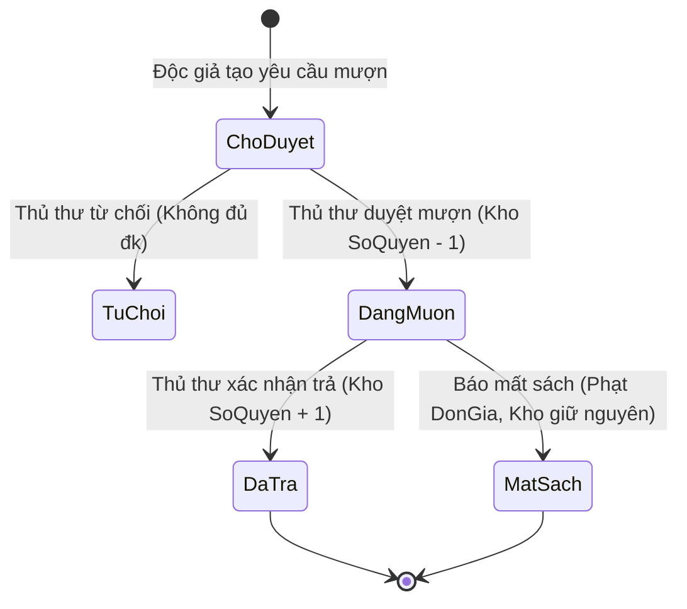

# 04. QUY TẮC NGHIỆP VỤ & LUỒNG HOẠT ĐỘNG (FLOW LOGIC)

Tài liệu này định nghĩa chính xác các quy trình vận hành thực tế của thư viện.

---

## 1. Quy Trình Mượn Sách & Phê Duyệt

### Ràng buộc điều kiện mượn:
1. **Trạng thái thẻ độc giả**:
   - Nếu `TrangThaiThe !== "HoatDong"` (ví dụ `"Khoa"` hoặc `"Blacklist"`): Hệ thống lập tức **từ chối** tạo yêu cầu mượn.
2. **Số lượng sách mượn tối đa**:
   - Mỗi độc giả chỉ được mượn tối đa **3 quyển** ở trạng thái đang lưu thông (`ChoDuyet` + `DangMuon`). Nếu đã đủ 3 quyển, phải trả sách cũ mới được mượn tiếp.
3. **Kiểm tra tồn kho**:
   - Sách muốn mượn phải có `SoQuyen > 0`.
   - Khi tạo yêu cầu: Sách ở trạng thái `ChoDuyet` (chưa trừ kho).
   - Khi Thủ thư bấm **Phê duyệt**: Hệ thống kiểm tra lại kho một lần nữa và thực hiện trừ kho: `SoQuyen = SoQuyen - 1`, chuyển trạng thái thành `DangMuon`. Hạn trả mặc định: `NgayHenTra = NgayMuon + 14 ngày`.

---

## 2. Quy Trình Trả Sách & Xử Lý Vi Phạm / Quá Hạn

1. **Trả sách đúng hạn**:
   - Thủ thư kiểm tra tình trạng sách và bấm **Xác nhận Đã Trả**.
   - Cập nhật phiếu mượn: `TrangThai = "DaTra"`, `NgayTra = hiện tại`.
   - Hoàn trả lại kho: `SoQuyen = SoQuyen + 1`.
2. **Trả sách quá hạn (`NgayTra > NgayHenTra`)**:
   - Hệ thống tự động tính số ngày trễ.
   - Tăng chỉ số vi phạm của độc giả: `SoLanViPham = SoLanViPham + 1`.
   - **Quy tắc Blacklist (Danh sách đen)**:
     - Nếu `SoLanViPham >= 3`: Hệ thống tự động chuyển thẻ của độc giả sang `TrangThaiThe = "Blacklist"`, tước quyền mượn sách.

---

## 3. Quy Trình Xử Lý Mất Sách (`MatSach`)

Khi độc giả làm mất sách mượn:
1. Thủ thư chuyển trạng thái phiếu mượn sang `MatSach`.
2. **Xử lý số lượng kho**: Không cộng lại `SoQuyen` (vì sách đã mất thật sự).
3. **Chế tài tài chính & kỷ luật**:
   - Tính tiền bồi thường bằng đơn giá sách: `TienPhat = Sach.DonGia`.
   - Tăng số lần vi phạm của độc giả lên 1: `SoLanViPham = SoLanViPham + 1`.
   - Nếu tái phạm làm mất sách nhiều lần dẫn đến `SoLanViPham >= 3`: Khóa thẻ đưa vào danh sách đen.

---

## 4. Phân Quyền Quản Trị Hệ Thống (Admin & User Promotion)

Admin có trang chuyên biệt để quản lý nhân sự:
* **Nâng cấp (Promote)**: Admin có thể nâng một người dùng thông thường (`Role: "USER"`) lên làm Quản lý/Thủ thư (`Role: "MANAGER"`). Khi đó, người dùng này có quyền truy cập vào giao diện quản lý sách, duyệt đơn mượn và xử lý trả/mất sách.
* **Hạ cấp (Demote)**: Admin có thể hạ quyền của một Quản lý trở về lại Độc giả thông thường (`Role: "USER"`).
* **Mở khóa Blacklist**: Chỉ Admin mới có quyền xóa lịch sử vi phạm (`SoLanViPham = 0`) và khôi phục trạng thái `HoatDong` cho độc giả bị phạt.
