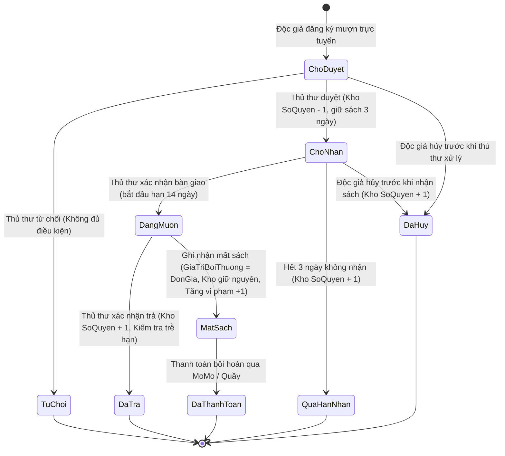

# 04. QUY TẮC NGHIỆP VỤ & LUỒNG HOẠT ĐỘNG (FLOW LOGIC)

Tài liệu này định nghĩa chi tiết các quy tắc ràng buộc logic nghiệp vụ bám sát theo Báo cáo đề tài CT449.

---

## 1. Sơ Đồ Trạng Thái Vòng Đời Phiếu Mượn Sách

---

## 2. Ràng Buộc Điều Kiện Mượn Sách

1. **Trạng thái Thẻ Độc giả**:
   - `HoatDong`: Thẻ có thể đăng ký mượn nếu đáp ứng các điều kiện khác.
   - `Khoa`: Khóa khẩn cấp, ví dụ khi độc giả báo mất thẻ; hệ thống từ chối mượn cho đến khi Admin mở khóa.
   - `DanhSachDen`: Chế tài khi đạt từ 3 lần vi phạm; hệ thống từ chối mượn, khác với khóa khẩn cấp.
   - Cả `Khoa` và `DanhSachDen` đều bị từ chối mượn với HTTP 403, nhưng được quản lý bằng các thao tác riêng.
2. **Hạn mức mượn tối đa 3 cuốn**:
   - Mỗi độc giả chỉ được phép có tối đa 3 phiếu đang lưu thông (`ChoDuyet`, `ChoNhan`, `DangMuon`). Phiếu hết hạn nhận được đóng và giải phóng hạn mức.
   - Độc giả được hủy phiếu `ChoDuyet` hoặc `ChoNhan` trước khi nhận sách. Phiếu chuyển thành `DaHuy`, không xóa lịch sử; hủy `ChoDuyet` không đổi kho, hủy `ChoNhan` hoàn lại cuốn đã giữ.
   - Hủy, duyệt, bàn giao và từ chối dùng cập nhật có điều kiện. Chỉ một thao tác cạnh tranh có thể đổi trạng thái thành công; bàn giao không thể hoàn tất sau khi hết hạn nhận.
3. **Kiểm tra tồn kho thời gian thực**:
   - Chỉ cho phép đăng ký mượn khi sách có `SoQuyen > 0`.
   - `ChoDuyet`: Chưa trừ kho. Khi thủ thư duyệt, trừ `SoQuyen` một cuốn để giữ chỗ, chuyển sang `ChoNhan`, ghi `NgayDuyet` và `HanNhan = NgayDuyet + 3 ngày`. Độc giả có thể nhận đến hết ngày `HanNhan`.
   - Nếu qua hết `HanNhan` mà chưa nhận, hệ thống tự chuyển `QuaHanNhan`, cộng trả một cuốn vào kho, ghi audit và gửi thông báo. Tác vụ chạy khi backend khởi động, định kỳ mỗi phút và trước các lần đọc/đăng ký mượn để trạng thái/kho được cập nhật.
   - Tại quầy, thủ thư chỉ chọn **Xác nhận giao sách** sau khi bàn giao vật lý. Khi đó chuyển `ChoNhan` sang `DangMuon`, ghi `NgayMuon` bằng ngày bàn giao và `NgayHenTra = NgayMuon + 14 ngày`; ghi nhận nhân viên bàn giao. Duyệt không bắt đầu thời hạn mượn.
4. **Gia hạn mượn sách**:
   - Chủ phiếu là độc giả đã đăng nhập, phiếu đang `DangMuon`, còn trước ngày `NgayHenTra` và `SoLanGiaHan = 0` mới được gia hạn.
   - Mỗi phiếu chỉ gia hạn tối đa một lần; hạn trả mới bằng hạn hiện tại cộng 7 ngày, không tính lại từ ngày thao tác.
   - Không cho gia hạn vào chính ngày đến hạn hoặc sau hạn. Cập nhật có điều kiện để tránh gia hạn lặp do nhiều request đồng thời.
   - Ghi `SoLanGiaHan = 1`, `NgayGiaHan`, audit `PHIEU_GIA_HAN` và thông báo kết quả cho độc giả. Thao tác này không làm thay đổi tồn kho hay trạng thái phiếu.

---

## 3. Quy Trình Hoàn Trả Sách & Xử Lý Vi Phạm Trễ Hạn

1. **Hoàn trả đúng hạn (`NgayTra <= NgayHenTra`)**:
   - Thủ thư kiểm tra tình trạng sách tại quầy và nhấn **Xác nhận trả**.
   - Cập nhật: `TrangThai = "DaTra"`, `NgayTra = hiện tại`.
   - Hoàn trả lại kho: `SoQuyen = SoQuyen + 1`.
2. **Hoàn trả trễ hạn (`NgayTra > NgayHenTra`)**:
   - Hệ thống tự động phát hiện trễ hạn, ghi chú "Đã trả (Quá hạn mượn quy định)".
   - Tăng số lần vi phạm của độc giả: `SoLanViPham = SoLanViPham + 1`.
   - **Quy tắc đưa vào Danh sách đen tự động**:
     - Nếu lần vi phạm vừa ghi nhận làm `SoLanViPham` đạt từ 3 trở lên: Hệ thống tự động chuyển trạng thái thẻ sang `TrangThaiThe = "DanhSachDen"`, tước quyền mượn sách kể cả khi thẻ trước đó đang `Khoa`.

---

## 4. Quy Trình Báo Mất Sách & Thanh Toán Bồi Thường

1. Độc giả báo mất sách hoặc thủ thư kiểm kê phát hiện mất:
   - Thủ thư chuyển trạng thái phiếu sang `MatSach`.
   - **Không cộng hoàn trả kho** `SoQuyen` (sách bị mất thật sự).
   - Tự động gán tiền bồi hoàn: `GiaTriBoiThuong = Sach.DonGia`.
   - Tăng số lần vi phạm của độc giả lên 1: `SoLanViPham = SoLanViPham + 1`. Nếu đạt 3 lần, thẻ độc giả bị đưa vào `DanhSachDen`.
2. **Thanh toán bồi hoàn qua MoMo (chưa triển khai)**:
   - Tài liệu nghiệp vụ dự kiến tạo đường dẫn MoMo QR Code / App Deeplink và xác thực Webhook IPN.
   - Backend hiện chưa có payment route/service/controller; không hiển thị đây là luồng đã hoạt động cho tới khi được triển khai và kiểm thử.

---

## 5. Phân Quyền Quản Trị Hệ Thống (RBAC - Role-Based Access Control)

Hệ thống thiết lập 3 vai trò người dùng phân cấp rõ ràng:
1. **Độc giả (`USER`)**:
   - Tra cứu, tìm kiếm, lọc sách và nhà xuất bản.
   - Đăng ký mượn sách trực tuyến (tối đa 3 quyển).
   - Hủy yêu cầu mượn của chính mình khi phiếu chưa được thủ thư duyệt.
   - Theo dõi lịch sử mượn trả, hạn trả và tình trạng vi phạm cá nhân.
2. **Thủ thư (`STAFF`)**:
   - Có thể truy cập các chức năng công khai của cổng Độc giả (tra cứu sách/NXB); cổng quản lý có liên kết mở cổng Độc giả.
   - Có toàn bộ chức năng nghiệp vụ thủ thư. Tài khoản nhân viên và tài khoản độc giả là hai hồ sơ/phiên độc lập; các thao tác gắn với thẻ độc giả (đăng ký mượn, hồ sơ, lịch sử cá nhân) chỉ khả dụng khi đăng nhập bằng tài khoản độc giả tương ứng. Chưa có cơ chế liên kết hai hồ sơ.
   - Quản lý kho sách (Thêm, Sửa, Xóa, kiểm kê số lượng).
   - Quản lý danh mục Nhà xuất bản.
   - Xử lý quy trình mượn - trả: Phê duyệt đơn mượn (trừ kho), xác nhận trả (cộng kho), từ chối mượn, báo mất sách.
3. **Quản trị viên tối cao (`ADMIN`)**:
   - Kế thừa toàn bộ chức năng nghiệp vụ của Thủ thư và có thể truy cập các chức năng công khai của cổng Độc giả.
   - Tài khoản quản trị vẫn tách khỏi tài khoản độc giả; thao tác hồ sơ/mượn cá nhân cần đăng nhập phiên độc giả riêng nếu có.
   - Quản lý danh sách toàn bộ tài khoản người dùng và nhân viên.
   - Xét duyệt/từ chối hồ sơ ứng tuyển nhân viên. Chỉ khi được duyệt mới sinh hồ sơ nhân viên `STAFF`; hồ sơ độc giả không được chuyển đổi.
   - Khóa khẩn cấp thẻ đang hoạt động (`HoatDong` → `Khoa`) và mở khóa (`Khoa` → `HoatDong`); không thay đổi `SoLanViPham`. Nếu đã đạt 3 lần vi phạm, khi mở khóa thẻ chuyển thành `DanhSachDen`.
   - Xét gỡ khỏi Danh sách đen bằng thao tác riêng (`DanhSachDen` → `HoatDong`); đặt `SoLanViPham = 0` để bắt đầu chu kỳ theo dõi mới theo quyết định có chủ đích của Admin. Nhật ký kiểm toán vẫn lưu các sự kiện vi phạm và quyết định xét gỡ trước đó.
   - Sau khi gỡ, JWT độc giả hiện tại vẫn hợp lệ; frontend đồng bộ hồ sơ qua `/api/auth/me` khi nhận thông báo thay đổi trạng thái và kiểm tra trạng thái mới nhất ngay trước khi mở luồng mượn. API mượn luôn đối chiếu MongoDB, không dùng trạng thái cache trong JWT/localStorage làm quyền quyết định.
   - Quyền xóa tài khoản vi phạm vĩnh viễn khỏi CSDL.
   - Được khóa/mở khóa tài khoản thủ thư bằng `nhanvien.TrangThaiThe`; không khóa tài khoản Admin. Backend từ chối yêu cầu tự khóa, kể cả khi Admin gọi API trực tiếp.
   - Khi khóa, tăng `PhienBanToken`; đăng nhập mới bị từ chối và middleware chặn JWT đã cấp trước đó. Mở khóa chỉ cho phép phiên đăng nhập mới, không kích hoạt token cũ trở lại. Ghi lý do kiểm toán và thông báo thủ thư.
   - Nếu thủ thư nhập đúng số điện thoại và mật khẩu trong lúc tài khoản đang khóa, trả thông báo “Tài khoản thủ thư của bạn đang bị khóa...” để hướng dẫn liên hệ Admin; nếu thông tin xác thực sai, tiếp tục trả lỗi chung 401. Không cấp token khi tài khoản khóa.

### Ma trận quyền theo chức năng (thực thi bắt buộc tại Backend)

| Chức năng | Khách | USER | STAFF | ADMIN |
|:---|:---:|:---:|:---:|:---:|
| Tra cứu sách/NXB công khai | ✓ | ✓ | ✓ | ✓ |
| Tìm kiếm sách/NXB trên cổng quản lý | — | — | ✓ | ✓ |
| Đăng ký mượn, xem/cập nhật hồ sơ độc giả của chính mình | — | ✓ | —* | —* |
| Tạo phiếu cho độc giả, đọc danh sách độc giả/phiếu phục vụ nghiệp vụ | — | — | ✓ | ✓ |
| Thêm/sửa/xóa sách và NXB | — | — | ✓ | ✓ |
| Duyệt/từ chối/trả/báo mất phiếu | — | — | ✓ | ✓ |
| Ghi sự kiện kiểm toán sách và mượn-trả | — | — | ✓ | ✓ |
| Đọc/tìm kiếm nhật ký kiểm toán | — | — | — | ✓ |
| Xem/khôi phục sách đã xóa mềm | — | — | — | ✓ |
| Thăng/hạ quyền, khóa/mở khóa, xét gỡ danh sách đen, xóa tài khoản | — | — | — | ✓ |
| Khóa/mở khóa tài khoản thủ thư | — | — | — | ✓ |
| Cập nhật hồ sơ nhân viên của chính mình | — | — | ✓ | ✓ |

Mọi thao tác cần kiểm tra thêm quyền sở hữu hồ sơ/phiếu ở server; vai trò hoặc mã nhân viên gửi từ trình duyệt không được dùng làm nguồn thẩm quyền. Các route guard frontend chỉ hỗ trợ điều hướng.

`—*` áp dụng cho phiên nhân viên: STAFF/ADMIN hiện đăng nhập bằng hồ sơ `nhanvien`, không có `MaDocGia` và không dùng phiên `docgia`. Muốn thực hiện nghiệp vụ cá nhân của độc giả phải đăng nhập tài khoản độc giả riêng trên domain cổng độc giả. Không cấp quyền giả lập hồ sơ độc giả từ quyền nhân viên.

## 6. Nguyên tắc bảo mật ứng dụng

- Dự án dùng MongoDB Native Driver, vì vậy kiểm soát injection tập trung vào NoSQL injection: input theo schema, allowlist trường, truy vấn có cấu trúc, từ chối toán tử `$`/object không mong đợi; SQLi chỉ phát sinh nếu sau này thêm cơ sở dữ liệu SQL.
- Đối với XSS, chỉ render dữ liệu người dùng như text; không render HTML chưa sanitize. Áp dụng CSP/security headers.
- Xác thực hiện dùng JWT Bearer. Không dùng cookie thì CSRF cổ điển được giảm thiểu do token không tự gửi; nếu chuyển token sang cookie phải bổ sung SameSite/Secure/HttpOnly, CSRF token và kiểm tra Origin.
- Bảo vệ đăng nhập bằng bcrypt, lỗi chung, rate limiting, JWT có hạn dùng và khả năng thu hồi khi logout/đổi mật khẩu/khóa tài khoản; không ghi thông tin bí mật vào log.
- API không xử lý XML: không bật parser XML. Nếu có chức năng XML mới, phải tắt DTD/external entities/XInclude và chặn truy cập file/mạng.
- Không fetch URL tùy ý từ client. Tích hợp outbound chỉ dùng host allowlist và chống truy cập loopback/private/link-local/metadata để ngăn SSRF.

## 7. Luồng truy cập hai frontend/domain

- Độc giả truy cập `frontend_user/` (local `http://localhost:3001`, production domain riêng) để tra cứu sách, đăng ký mượn và quản lý hồ sơ cá nhân.
- Thủ thư/Admin truy cập `frontend_manage/` (local `http://localhost:3002`, production domain riêng) để thực hiện nghiệp vụ quản lý. STAFF có toàn bộ chức năng thủ thư; ADMIN có toàn bộ chức năng thủ thư cộng quản trị. Cổng quản lý cung cấp liên kết sang cổng độc giả để dùng chức năng công khai hoặc đăng nhập phiên độc giả riêng.
- Cả hai ứng dụng gọi chung Backend API tại cổng `3000` khi phát triển; CORS production chỉ cho phép hai origin được cấu hình. Khi đăng nhập, frontend điều hướng tới đúng cổng/domain theo vai trò.
- Mỗi domain có browser storage riêng; không phụ thuộc vào chia sẻ localStorage/cookie giữa hai app. Nếu token không tồn tại ở app đích, yêu cầu đăng nhập lại tại app đó. Backend luôn xác thực token và quyền, bất kể request đến từ domain nào.

## 8. Nhật ký kiểm toán và xóa mềm sách

- Mỗi thao tác thành công trên sách được ghi vào `nhatkykiemtoan`: thêm, sửa (các trường trước/sau), xóa mềm và khôi phục. Tác nhân lấy từ JWT; log có mã/tên nhân viên, mã/tên sách và thời điểm.
- Vòng đời phiếu mượn ghi các sự kiện độc giả đăng ký, nhân viên duyệt/giao, từ chối, xác nhận trả, ghi nhận mất và Admin xóa phiếu. Mỗi sự kiện lưu snapshot mã/tên sách, mã/tên độc giả, nhân viên chịu trách nhiệm và trạng thái trước/sau khi phù hợp.
- API log chỉ đọc, chỉ `ADMIN` được truy cập. Log append-only, không cung cấp route sửa/xóa; không lưu mật khẩu, JWT hoặc credential.
- Xóa sách đặt `deleted=true` và metadata thời gian/nhân viên, không xóa document khỏi MongoDB. Tra cứu công khai và đăng ký/duyệt mượn loại sách đã xóa; phiếu còn mở ngăn xóa mềm. Admin có thể xem danh sách đã xóa và khôi phục; thao tác khôi phục cũng được ghi log.
# Thông báo nghiệp vụ đến tài khoản

- Khi Admin khóa/mở khóa thẻ, gỡ danh sách đen hoặc đổi quyền độc giả, backend lưu thông báo vào hộp thư của độc giả đích.
- Khi Admin tạo tài khoản nhân viên, hệ thống ghi thông báo vào hộp thư nhân viên mới. Thao tác xóa nhân viên không thể gửi thông báo sau khi tài khoản bị xóa; cần thông báo trực tiếp trước khi thu hồi tài khoản nếu quy trình này được bổ sung.
- Khi Thủ thư/Admin duyệt hoặc từ chối yêu cầu mượn, xác nhận trả hoặc báo mất sách, độc giả nhận thông báo mô tả kết quả và thông tin liên quan. Trả trễ/bị đưa vào Danh sách đen có thông báo riêng.
- Mỗi sách tham chiếu đúng một thể loại chính qua `sach.MaTheLoai` tới `theloai.MaTheLoai`; backend từ chối mã thể loại không tồn tại. Danh mục được seed idempotent và dùng chung cho form nhập sách, trang quản lý kho và bộ lọc catalog.
- Hộp thư được lưu trong `thongbao`, không mất khi tải lại trang/đăng nhập lại. Header hai cổng tải số chưa đọc khi đăng nhập, cập nhật khi mở bảng, focus lại hoặc polling 30 giây. Người dùng chỉ đánh dấu đã đọc thông báo của chính mình.
- Lỗi lưu thông báo không làm đảo ngược nghiệp vụ đã hoàn tất; server ghi lỗi để vận hành theo dõi.
