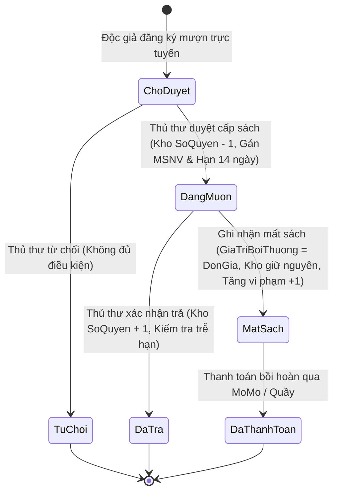

# 04. QUY TẮC NGHIỆP VỤ & LUỒNG HOẠT ĐỘNG (FLOW LOGIC)

Tài liệu này định nghĩa chi tiết các quy tắc ràng buộc logic nghiệp vụ bám sát theo Báo cáo đề tài CT449.

---

## 1. Sơ Đồ Trạng Thái Vòng Đời Phiếu Mượn Sách

---

## 2. Ràng Buộc Điều Kiện Mượn Sách

1. **Trạng thái Thẻ Độc giả**:
   - Nếu `TrangThaiThe === "Blacklist"` hoặc `TrangThaiThe === "Khoa"`: Hệ thống lập tức từ chối và phản hồi lỗi HTTP 403 Forbidden.
2. **Hạn mức mượn tối đa 3 cuốn**:
   - Mỗi độc giả chỉ được phép giữ tối đa 3 cuốn sách ở trạng thái đang lưu thông (`ChoDuyet` + `DangMuon`). Nếu đã đủ 3 cuốn, hệ thống từ chối yêu cầu mượn mới cho đến khi hoàn trả sách cũ.
3. **Kiểm tra tồn kho thời gian thực**:
   - Chỉ cho phép đăng ký mượn khi sách có `SoQuyen > 0`.
   - Trạng thái `ChoDuyet`: Chưa trừ kho.
   - Khi Thủ thư nhấn **Duyệt cấp sách**: Hệ thống tự động trừ kho `SoQuyen = SoQuyen - 1`, chuyển trạng thái sang `DangMuon`, gán ngày mượn và hạn trả (`NgayHenTra = NgayMuon + 14 ngày`), ghi nhận `MSNV` của nhân viên phụ trách duyệt.

---

## 3. Quy Trình Hoàn Trả Sách & Xử Lý Vi Phạm Trễ Hạn

1. **Hoàn trả đúng hạn (`NgayTra <= NgayHenTra`)**:
   - Thủ thư kiểm tra tình trạng sách tại quầy và nhấn **Xác nhận trả**.
   - Cập nhật: `TrangThai = "DaTra"`, `NgayTra = hiện tại`.
   - Hoàn trả lại kho: `SoQuyen = SoQuyen + 1`.
2. **Hoàn trả trễ hạn (`NgayTra > NgayHenTra`)**:
   - Hệ thống tự động phát hiện trễ hạn, ghi chú "Đã trả (Quá hạn mượn quy định)".
   - Tăng số lần vi phạm của độc giả: `SoLanViPham = SoLanViPham + 1`.
   - **Quy tắc Blacklist tự động**:
     - Nếu `SoLanViPham >= 3`: Hệ thống tự động chuyển trạng thái thẻ sang `TrangThaiThe = "Blacklist"`, tước quyền mượn sách.

---

## 4. Quy Trình Báo Mất Sách & Thanh Toán Bồi Thường

1. Độc giả báo mất sách hoặc thủ thư kiểm kê phát hiện mất:
   - Thủ thư chuyển trạng thái phiếu sang `MatSach`.
   - **Không cộng hoàn trả kho** `SoQuyen` (sách bị mất thật sự).
   - Tự động gán tiền bồi hoàn: `GiaTriBoiThuong = Sach.DonGia`.
   - Tăng số lần vi phạm của độc giả lên 1: `SoLanViPham = SoLanViPham + 1`. Nếu đạt 3 lần, thẻ độc giả bị đưa vào `Blacklist`.
2. **Tích hợp thanh toán bồi hoàn qua MoMo**:
   - Hệ thống hỗ trợ tạo đường dẫn thanh toán MoMo QR Code / App Deeplink để độc giả thanh toán trực tuyến tiền bồi thường.
   - Khi máy chủ MoMo gọi Webhook IPN, hệ thống tự động cập nhật trạng thái đã nộp phạt bồi hoàn.

---

## 5. Phân Quyền Quản Trị Hệ Thống (RBAC - Role-Based Access Control)

Hệ thống thiết lập 3 vai trò người dùng phân cấp rõ ràng:
1. **Độc giả (`USER`)**:
   - Tra cứu, tìm kiếm, lọc sách và nhà xuất bản.
   - Đăng ký mượn sách trực tuyến (tối đa 3 quyển).
   - Theo dõi lịch sử mượn trả, hạn trả và tình trạng vi phạm cá nhân.
2. **Thủ thư (`MANAGER`)**:
   - Kế thừa toàn bộ quyền của Độc giả.
   - Quản lý kho sách (Thêm, Sửa, Xóa, kiểm kê số lượng).
   - Quản lý danh mục Nhà xuất bản.
   - Xử lý quy trình mượn - trả: Phê duyệt đơn mượn (trừ kho), xác nhận trả (cộng kho), từ chối mượn, báo mất sách.
3. **Quản trị viên tối cao (`ADMIN`)**:
   - Kế thừa toàn bộ quyền hạn nghiệp vụ của Thủ thư.
   - Quản lý danh sách toàn bộ tài khoản người dùng và nhân viên.
   - Đặc quyền phân quyền: Thăng cấp Độc giả lên Thủ thư (`VaiTro: MANAGER`) hoặc hạ cấp Thủ thư về lại Độc giả (`VaiTro: USER`).
   - Mở khóa Blacklist: Xóa lịch sử vi phạm (`SoLanViPham = 0`) và khôi phục trạng thái hoạt động (`TrangThaiThe = "HoatDong"`).
   - Quyền xóa tài khoản vi phạm vĩnh viễn khỏi CSDL.
