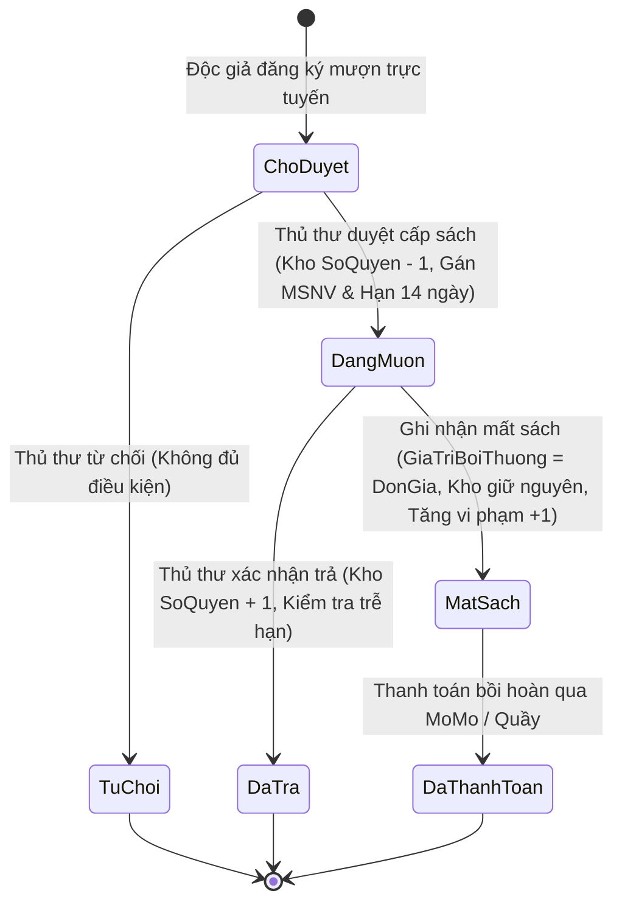

# 04. QUY TẮC NGHIỆP VỤ & LUỒNG HOẠT ĐỘNG (FLOW LOGIC)

Tài liệu này định nghĩa chi tiết các quy tắc ràng buộc logic nghiệp vụ bám sát theo Báo cáo đề tài CT449.

---

## 1. Sơ Đồ Trạng Thái Vòng Đời Phiếu Mượn Sách

---

## 2. Ràng Buộc Điều Kiện Mượn Sách

1. **Trạng thái Thẻ Độc giả**:
   - `HoatDong`: Thẻ có thể đăng ký mượn nếu đáp ứng các điều kiện khác.
   - `Khoa`: Khóa khẩn cấp, ví dụ khi độc giả báo mất thẻ; hệ thống từ chối mượn cho đến khi Admin mở khóa.
   - `DanhSachDen`: Chế tài khi đạt từ 3 lần vi phạm; hệ thống từ chối mượn, khác với khóa khẩn cấp.
   - Cả `Khoa` và `DanhSachDen` đều bị từ chối mượn với HTTP 403, nhưng được quản lý bằng các thao tác riêng.
2. **Hạn mức mượn tối đa 3 cuốn**:
   - Mỗi độc giả chỉ được phép giữ tối đa 3 cuốn sách ở trạng thái đang lưu thông (`ChoDuyet` + `DangMuon`). Nếu đã đủ 3 cuốn, hệ thống từ chối yêu cầu mượn mới cho đến khi hoàn trả sách cũ.
3. **Kiểm tra tồn kho thời gian thực**:
   - Chỉ cho phép đăng ký mượn khi sách có `SoQuyen > 0`.
   - Trạng thái `ChoDuyet`: Chưa trừ kho.
   - Khi Thủ thư nhấn **Duyệt cấp sách**: Hệ thống tự động trừ kho `SoQuyen = SoQuyen - 1`, chuyển trạng thái sang `DangMuon`, gán ngày mượn và hạn trả (`NgayHenTra = NgayMuon + 14 ngày`), ghi nhận `MSNV` của nhân viên phụ trách duyệt.

---

## 3. Quy Trình Hoàn Trả Sách & Xử Lý Vi Phạm Trễ Hạn

1. **Hoàn trả đúng hạn (`NgayTra <= NgayHenTra`)**:
   - Thủ thư kiểm tra tình trạng sách tại quầy và nhấn **Xác nhận trả**.
   - Cập nhật: `TrangThai = "DaTra"`, `NgayTra = hiện tại`.
   - Hoàn trả lại kho: `SoQuyen = SoQuyen + 1`.
2. **Hoàn trả trễ hạn (`NgayTra > NgayHenTra`)**:
   - Hệ thống tự động phát hiện trễ hạn, ghi chú "Đã trả (Quá hạn mượn quy định)".
   - Tăng số lần vi phạm của độc giả: `SoLanViPham = SoLanViPham + 1`.
   - **Quy tắc đưa vào Danh sách đen tự động**:
     - Nếu lần vi phạm vừa ghi nhận làm `SoLanViPham` đạt từ 3 trở lên: Hệ thống tự động chuyển trạng thái thẻ sang `TrangThaiThe = "DanhSachDen"`, tước quyền mượn sách kể cả khi thẻ trước đó đang `Khoa`.

---

## 4. Quy Trình Báo Mất Sách & Thanh Toán Bồi Thường

1. Độc giả báo mất sách hoặc thủ thư kiểm kê phát hiện mất:
   - Thủ thư chuyển trạng thái phiếu sang `MatSach`.
   - **Không cộng hoàn trả kho** `SoQuyen` (sách bị mất thật sự).
   - Tự động gán tiền bồi hoàn: `GiaTriBoiThuong = Sach.DonGia`.
   - Tăng số lần vi phạm của độc giả lên 1: `SoLanViPham = SoLanViPham + 1`. Nếu đạt 3 lần, thẻ độc giả bị đưa vào `DanhSachDen`.
2. **Thanh toán bồi hoàn qua MoMo (chưa triển khai)**:
   - Tài liệu nghiệp vụ dự kiến tạo đường dẫn MoMo QR Code / App Deeplink và xác thực Webhook IPN.
   - Backend hiện chưa có payment route/service/controller; không hiển thị đây là luồng đã hoạt động cho tới khi được triển khai và kiểm thử.

---

## 5. Phân Quyền Quản Trị Hệ Thống (RBAC - Role-Based Access Control)

Hệ thống thiết lập 3 vai trò người dùng phân cấp rõ ràng:
1. **Độc giả (`USER`)**:
   - Tra cứu, tìm kiếm, lọc sách và nhà xuất bản.
   - Đăng ký mượn sách trực tuyến (tối đa 3 quyển).
   - Theo dõi lịch sử mượn trả, hạn trả và tình trạng vi phạm cá nhân.
2. **Thủ thư (`MANAGER`)**:
   - Kế thừa toàn bộ quyền của Độc giả.
   - Quản lý kho sách (Thêm, Sửa, Xóa, kiểm kê số lượng).
   - Quản lý danh mục Nhà xuất bản.
   - Xử lý quy trình mượn - trả: Phê duyệt đơn mượn (trừ kho), xác nhận trả (cộng kho), từ chối mượn, báo mất sách.
3. **Quản trị viên tối cao (`ADMIN`)**:
   - Kế thừa toàn bộ quyền hạn nghiệp vụ của Thủ thư.
   - Quản lý danh sách toàn bộ tài khoản người dùng và nhân viên.
   - Đặc quyền phân quyền: Thăng cấp Độc giả lên Thủ thư (`VaiTro: MANAGER`) hoặc hạ cấp Thủ thư về lại Độc giả (`VaiTro: USER`).
   - Khóa khẩn cấp thẻ đang hoạt động (`HoatDong` → `Khoa`) và mở khóa (`Khoa` → `HoatDong`); không thay đổi `SoLanViPham`. Nếu đã đạt 3 lần vi phạm, khi mở khóa thẻ chuyển thành `DanhSachDen`.
   - Xét gỡ khỏi Danh sách đen bằng thao tác riêng (`DanhSachDen` → `HoatDong`); giữ nguyên `SoLanViPham` để bảo toàn lịch sử. Vi phạm mới tiếp tục cộng dồn và sẽ áp dụng lại chế tài khi đạt ngưỡng.
   - Quyền xóa tài khoản vi phạm vĩnh viễn khỏi CSDL.

### Ma trận quyền theo chức năng (thực thi bắt buộc tại Backend)

| Chức năng | Khách | USER | MANAGER | ADMIN |
|:---|:---:|:---:|:---:|:---:|
| Tra cứu sách/NXB công khai | ✓ | ✓ | ✓ | ✓ |
| Đăng ký mượn, xem/cập nhật hồ sơ của chính mình | — | ✓ | — | — |
| Tạo phiếu cho độc giả, đọc danh sách độc giả/phiếu phục vụ nghiệp vụ | — | — | ✓ | ✓ |
| Thêm/sửa/xóa sách và NXB | — | — | ✓ | ✓ |
| Duyệt/từ chối/trả/báo mất phiếu | — | — | ✓ | ✓ |
| Thăng/hạ quyền, khóa/mở khóa, xét gỡ danh sách đen, xóa tài khoản | — | — | — | ✓ |
| Cập nhật hồ sơ nhân viên của chính mình | — | — | ✓ | ✓ |

Mọi thao tác cần kiểm tra thêm quyền sở hữu hồ sơ/phiếu ở server; vai trò hoặc mã nhân viên gửi từ trình duyệt không được dùng làm nguồn thẩm quyền. Các route guard frontend chỉ hỗ trợ điều hướng.

## 6. Nguyên tắc bảo mật ứng dụng

- Dự án dùng MongoDB Native Driver, vì vậy kiểm soát injection tập trung vào NoSQL injection: input theo schema, allowlist trường, truy vấn có cấu trúc, từ chối toán tử `$`/object không mong đợi; SQLi chỉ phát sinh nếu sau này thêm cơ sở dữ liệu SQL.
- Đối với XSS, chỉ render dữ liệu người dùng như text; không render HTML chưa sanitize. Áp dụng CSP/security headers.
- Xác thực hiện dùng JWT Bearer. Không dùng cookie thì CSRF cổ điển được giảm thiểu do token không tự gửi; nếu chuyển token sang cookie phải bổ sung SameSite/Secure/HttpOnly, CSRF token và kiểm tra Origin.
- Bảo vệ đăng nhập bằng bcrypt, lỗi chung, rate limiting, JWT có hạn dùng và khả năng thu hồi khi logout/đổi mật khẩu/khóa tài khoản; không ghi thông tin bí mật vào log.
- API không xử lý XML: không bật parser XML. Nếu có chức năng XML mới, phải tắt DTD/external entities/XInclude và chặn truy cập file/mạng.
- Không fetch URL tùy ý từ client. Tích hợp outbound chỉ dùng host allowlist và chống truy cập loopback/private/link-local/metadata để ngăn SSRF.

## 7. Luồng truy cập hai frontend/domain

- Độc giả truy cập `frontend_user/` (local `http://localhost:3001`, production domain riêng) để tra cứu sách, đăng ký mượn và quản lý hồ sơ cá nhân.
- Thủ thư/Admin truy cập `frontend_manage/` (local `http://localhost:3002`, production domain riêng) để thực hiện nghiệp vụ quản lý. Route Admin chỉ dành `ADMIN`; route thủ thư dành `MANAGER` và `ADMIN`.
- Cả hai ứng dụng gọi chung Backend API tại cổng `3000` khi phát triển; CORS production chỉ cho phép hai origin được cấu hình. Khi đăng nhập, frontend điều hướng tới đúng cổng/domain theo vai trò.
- Mỗi domain có browser storage riêng; không phụ thuộc vào chia sẻ localStorage/cookie giữa hai app. Nếu token không tồn tại ở app đích, yêu cầu đăng nhập lại tại app đó. Backend luôn xác thực token và quyền, bất kể request đến từ domain nào.
